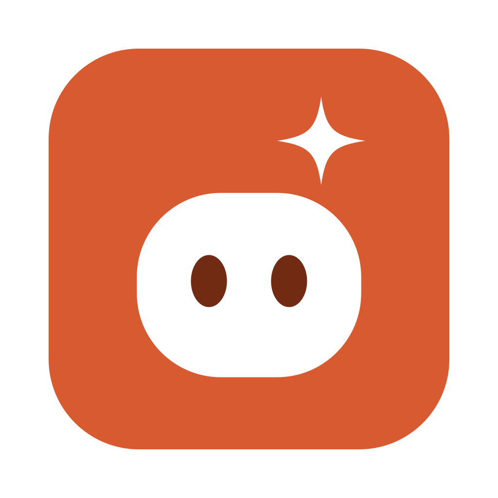
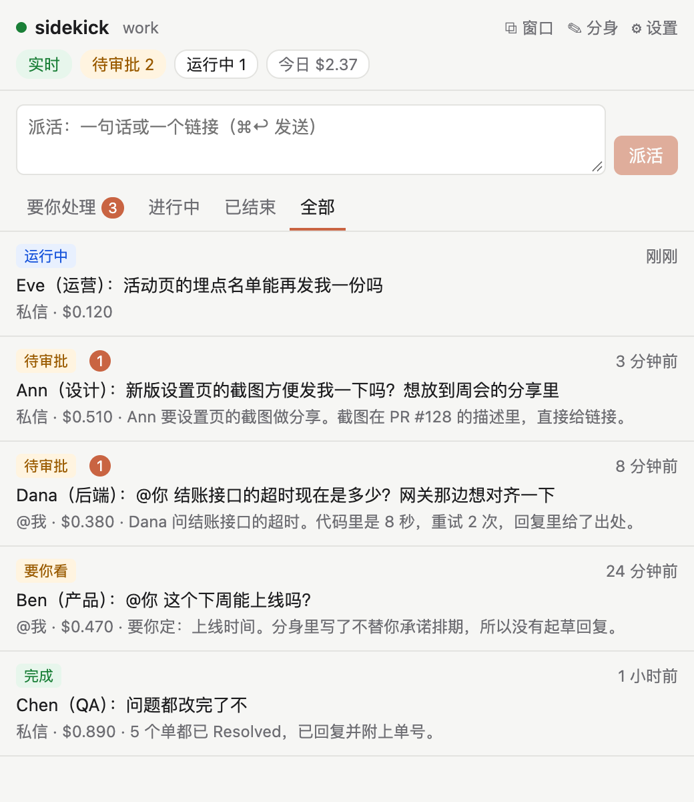
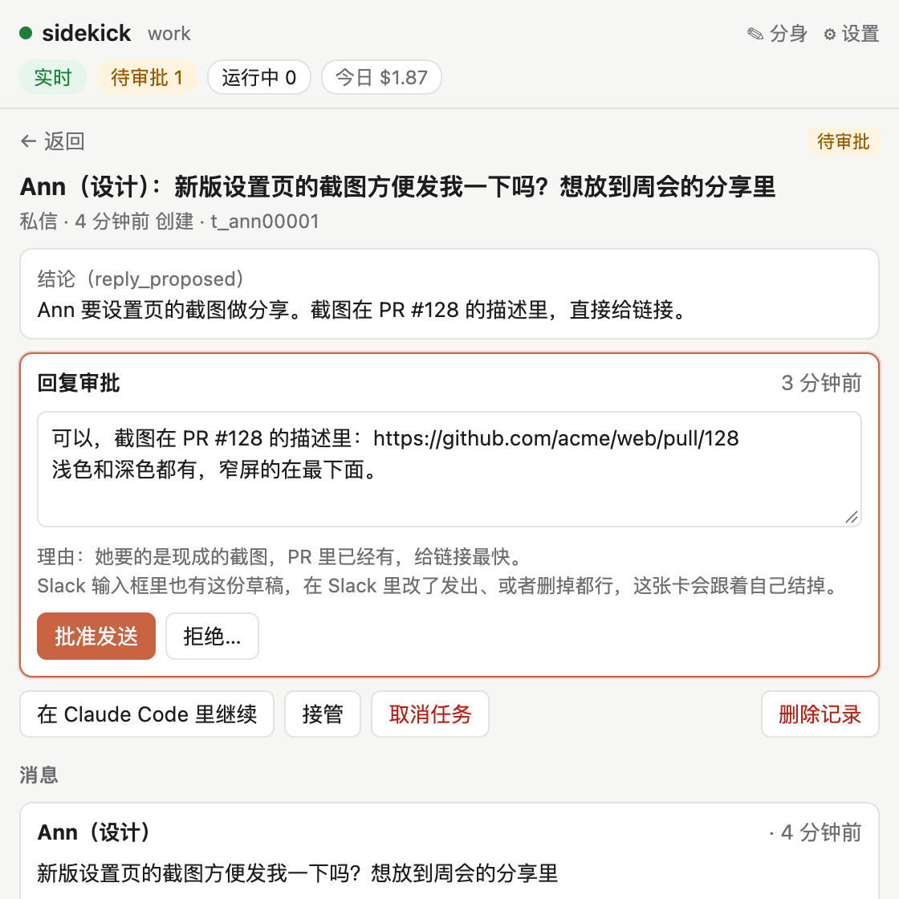
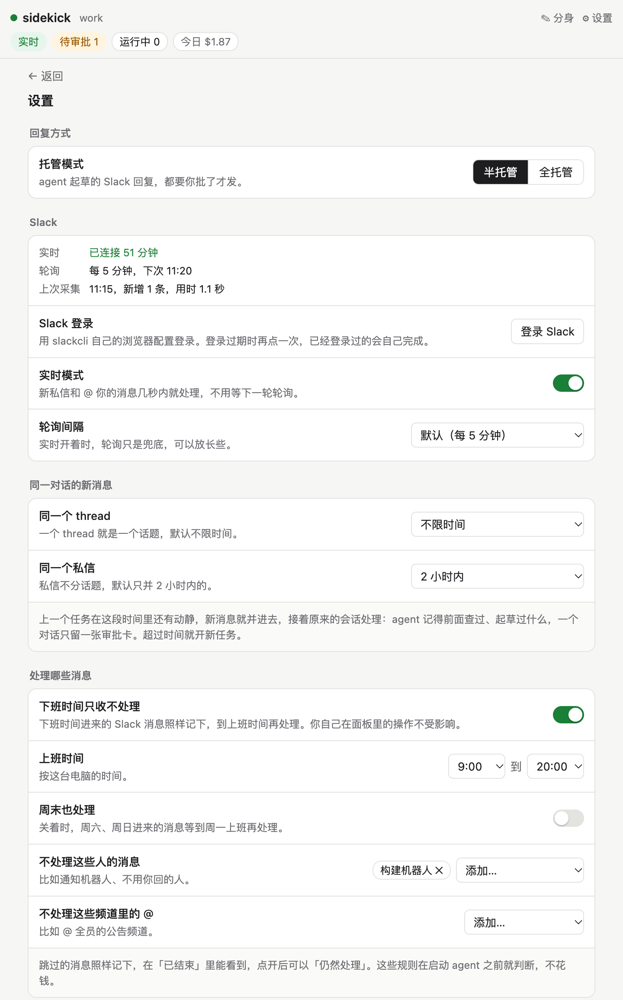

<p align="center">
  
</p>

<h1 align="center">sidekick</h1>

<p align="center">
  A macOS menu bar agent that drafts your Slack replies with Claude Code, and sends nothing without your approval.
</p>

<p align="center"><b>English</b> · <a href="README.zh-CN.md">简体中文</a></p>

<p align="center">
  
  
</p>

sidekick watches your Slack DMs and the messages that @-mention you. For each one, an agent running on [Claude Code](https://code.claude.com) decides whether you need to reply, checks the facts (it can read your code), and drafts the reply. You approve it in the panel, or edit and send it from Slack yourself.

> The interface follows your Mac's language, English or Chinese; switch it at the top of Settings. What the agent writes for you (conclusions, reasons, summaries) is in Chinese for now, and its Slack replies follow the language of the conversation.

## How it works

```
an unread DM to you, or a message that @-mentions you
  → the agent (Claude Code, one session per conversation): does this need a reply?
    if so, it checks the facts and drafts one → approval card; the draft also waits in Slack's message box
  → you approve it in the app, or edit and send it yourself in Slack → the card closes
```

- **Approvals first.** By default every reply waits for you. Full auto mode sends replies on its own, for when you're on leave or at lunch. It can switch on by schedule, and every auto-sent reply is copied to you.
- **Your persona.** Tell it who you are, what you own, how you talk, and what it must never promise for you. Don't want to write it by hand? Copy a prompt and let your own Claude Code interview you and write it from the replies you've corrected.
- **Signed replies.** A grey line above each reply it sends says an assistant drafted it, and whether you had approved it.
- **One conversation, one task.** Follow-ups in a thread or a DM join the same task and resume the same Claude session, with a single approval card per conversation.
- **Rules before the agent runs, at no cost.** Skip certain people or channels; outside working hours, take messages in but work on them later.
- **Hand over to yourself.** Not happy with a draft? "Continue in Claude" opens the task's session, with everything it looked up, in the Claude desktop app or Claude Code in Terminal. It is on the task, on its notifications, and offered when you delete a draft in Slack.
- **Local.** The task ledger, your persona and your settings stay on your Mac.

## Install

Requirements: a Mac with Apple silicon (macOS 13 or later), [Claude Code](https://code.claude.com) installed and signed in (`~/.local/bin/claude`), and Google Chrome (or Edge, or Brave) for signing in to Slack. You need neither Bun nor this repository: the daemon and slackcli are compiled into Sidekick.app.

1. Run this in Terminal. It downloads the latest release, verifies it, puts Sidekick.app in Applications and opens it. Downloaded with curl, the app carries no quarantine flag, so macOS won't block it.

   ```bash
   curl -fsSL https://raw.githubusercontent.com/lilong7676/sidekick/main/scripts/install.sh | bash
   ```

2. On launch the app installs the daemon as a LaunchAgent (`~/Library/LaunchAgents/local.sidekick.daemon.plist`), and macOS will say a background item was added. If the panel can't reach the daemon, open System Settings → General → Login Items, turn on sidekick under "Allow in the Background", and reopen Sidekick.
3. Click ✨ in the menu bar and choose a folder as the workspace. The agent runs there and can read the code in it, so the parent folder of your repositories is a good choice. A folder without `sidekick/profile.yaml` gets a profile, a Slack workflow and a persona template.
4. "Get started" on the home page walks you through the rest:
   - Sign in to Slack once, in a separate Chrome window that the button opens. It is not your everyday browser: Chrome won't let sidekick read the sign-in from your own profile. The window keeps the session, so when it expires, one click signs you in again.
   - Write your persona.
   - Allow notifications.

   Then pick a past message and do a "Dry run" to see what it would have done.

If something is off, open Settings → Diagnostics. Every failing check says how to fix it.

### Upgrade

When a new version is out, the panel shows "New version x" at the top. Click it, then "Upgrade": Terminal reruns the install command, and the new version opens. Running tasks are queued again and resume within seconds. Rerunning the install command yourself does the same.

## Using it

Left-click ✨ for the panel; right-click for a separate window, restarting the daemon, and launch at login. Pending approvals show up as notifications you can approve or deny right there. The draft also waits in Slack's message box: send it from Slack, edited or not, or delete it, and the card in sidekick closes on its own.

Slack is polled every 5 minutes. Realtime mode (Settings → Slack) handles new messages within seconds over Slack web's own websocket, and falls back to polling when that misbehaves.

### Settings



In Settings you can:

- switch the interface language: follow the system, 中文 or English (Language);
- turn full auto on a schedule (Scheduled full auto), e.g. 12:00–13:30 on weekdays;
- turn the signature line off (Signature line);
- set how long a conversation keeps its task (Follow-ups in a conversation): a thread with no time limit and a DM for 2 hours by default;
- set which messages to skip and the working hours (Which messages);
- set which notifications you get: macOS notifications, and a Slack DM to yourself that reaches your phone (Notifications);
- choose where "Continue in Claude" opens: the Claude desktop app or Terminal (Continue in Claude).

The panel also opens in a browser at `http://127.0.0.1:47321`. The first time, paste the `token` from `~/.config/sidekick/runtime.json`.

## Command line

With the app installed, the CLI is `/Applications/Sidekick.app/Contents/Resources/bin/sidekick`; from source, `bun src/cli.ts`:

```bash
sidekick tasks                  # open tasks
sidekick approvals              # waiting for approval
sidekick approve <id>           # approve; --text-file rewrites the reply
sidekick deny <id> --note "…"   # deny; with a note the agent tries again
sidekick add "something to do"  # give it a task by hand
sidekick takeover <task>        # pause a task and print the command to drive its session yourself
sidekick task <task>            # task details
sidekick doctor                 # the same checks as the panel's diagnostics
```

## Build from source

You need [Bun](https://bun.sh) and the Xcode command line tools.

```bash
cd app && make install && make run   # compile the daemon and slackcli, assemble Sidekick.app, install and open it
cd app && make zip                   # the same app/build/Sidekick-v<version>.zip a release ships
```

How it's put together: a Bun daemon (task ledger in SQLite, local HTTP API and the web panel), a Swift menu bar app that hosts the panel and keeps the daemon running as a LaunchAgent, and [slackcli](https://github.com/lilong7676/slackcli) for Slack. Pushing a `v*` tag builds a release with GitHub Actions. Design notes live in [docs/plan.md](docs/plan.md) and [docs/adr/](docs/adr/) (in Chinese).

## Privacy and disclaimer

- sidekick keeps no data off your Mac and collects nothing. Messages and code it reads go to Claude through your own Claude Code, as any Claude Code session does.
- Slack access goes through slackcli with a Slack web session, the one you sign in to in sidekick's own Chrome window, and in realtime mode Slack web's internal websocket. These are not official Slack APIs: they can break, and your workspace's policies may not allow them. Check before you use it at work. Provided for personal learning and research.
- Replies go out under your name. In the default mode they wait for your approval; in full auto mode they don't, and what is sent is your responsibility.

## License

[MIT](LICENSE)
