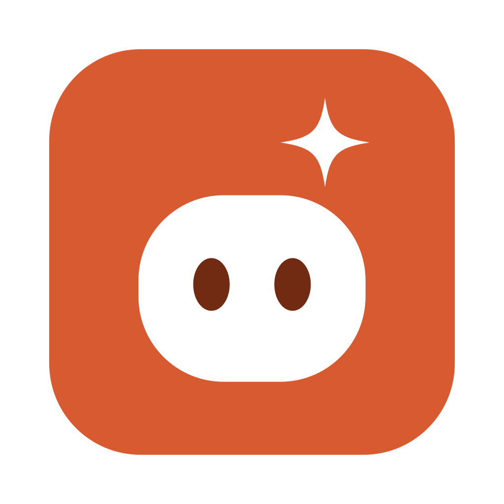
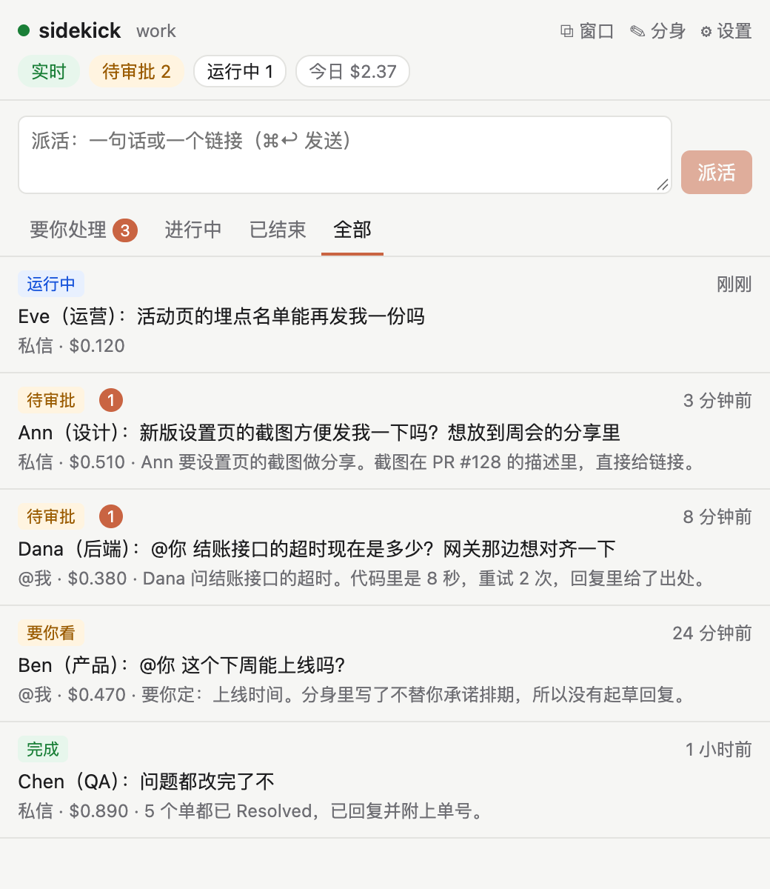
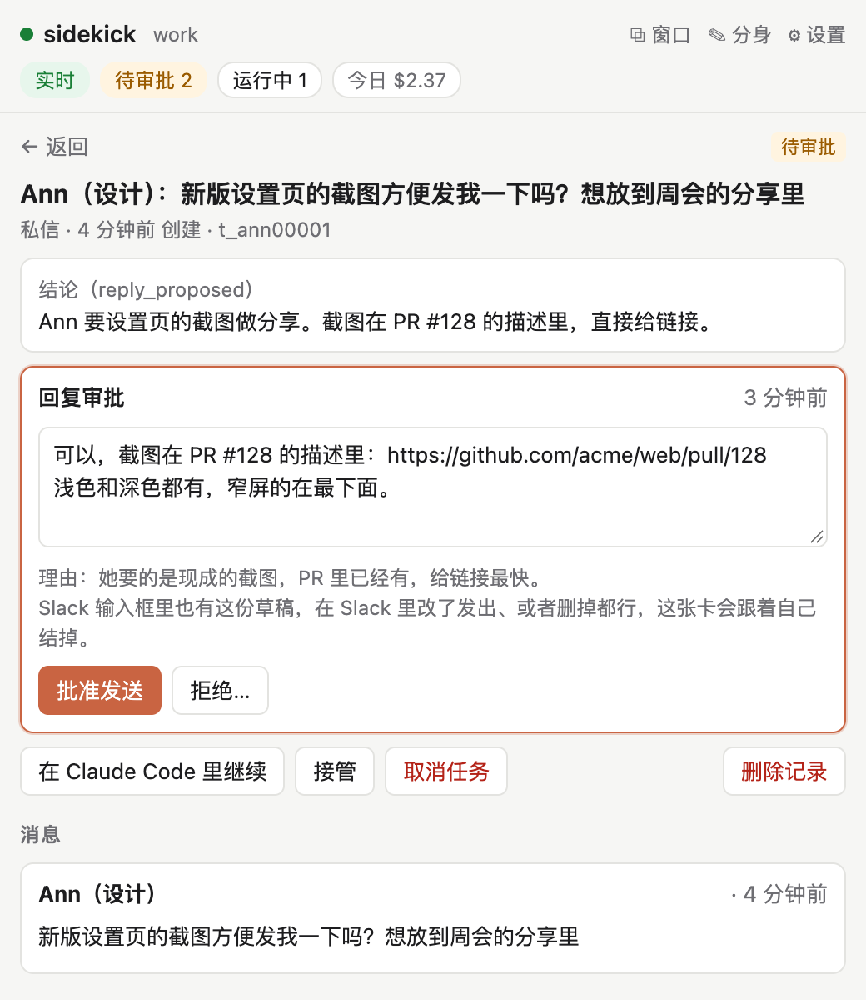
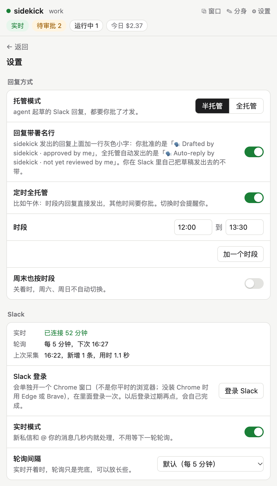

<p align="center">
  
</p>

<h1 align="center">sidekick</h1>

<p align="center">
  住在 macOS 菜单栏里的 Slack 助手：用 Claude Code 起草回复，经你批准才发出。
</p>

<p align="center"><a href="README.md">English</a> · <b>简体中文</b></p>

<p align="center">
  
  
</p>

私信你、@ 你的 Slack 消息，sidekick 都会交给跑在 [Claude Code](https://code.claude.com) 上的 agent：先判断要不要回，要回就查证据（能读你的代码）、起草回复。你在面板里批准，或者在 Slack 里自己改了发出都行。

## 它怎么处理一条 Slack 消息

```
未读的私信我 / @ 我
  → agent（Claude Code，一个对话一个会话）：要不要回？要回就查证据、起草 → 审批卡，草稿同时放进 Slack 输入框
  → 你在面板里批准，或者在 Slack 里自己改了发出 → 卡结掉
```

- **先审批再发出**：默认每条回复都等你批。全托管时直接发出（请假、午休用），可以按时间表自动切换，每条自动发出的都私信你一份。
- **分身**：写清你是谁、负责什么、怎么说话、哪些事不能替你答应。不想手写，就复制一段 prompt 交给你自己的 Claude Code，它会问你几个问题，参考你最近改过的回复帮你写好。
- **署名行**：sidekick 发出的回复上面有一行灰色小字，说明是助手起草的、你批没批过。
- **一个对话一个任务**：同一个 thread 或私信里的后续消息并进同一个任务，接着同一个会话处理，一个对话只留一张审批卡。
- **处理前过滤，不花钱**：可以不处理某些人、某些频道；下班时间只收不处理。
- **交还给你**：「在 Claude Code 里继续」在你自己的 Claude Code 里打开这个任务的会话，可以是终端，也可以是 Claude 桌面 app。
- **数据在本机**：任务账本、分身、设置都只在你的 Mac 上。

## 安装

前提：
- Apple 芯片的 Mac，macOS 13 起；
- [Claude Code](https://code.claude.com) 已安装并登录（`~/.local/bin/claude`）；
- 装了 Google Chrome（或 Edge、Brave），登录 Slack 时要用。

不用装 Bun，也不用这个仓库：daemon 和 slackcli 都编进了 Sidekick.app。

1. 在终端运行这一行：下载最新版、校验、装进「应用程序」并打开。用 curl 下载的 app 不带隔离标记，不用再手动放行。

   ```bash
   curl -fsSL https://raw.githubusercontent.com/lilong7676/sidekick/main/scripts/install.sh | bash
   ```

2. app 打开后会把 daemon 装成后台常驻（`~/Library/LaunchAgents/local.sidekick.daemon.plist`），macOS 会提示「已添加后台项目」。面板一直连不上的话，去 系统设置 → 通用 → 登录项，在「允许在后台」里打开 sidekick，再重新打开 Sidekick。
3. 点菜单栏的 ✨，选一个文件夹当工作区：agent 在这里运行，能读里面的代码，建议选放代码仓库的上一级目录。没有 `sidekick/profile.yaml` 的文件夹，会按模板建好 profile、处理 Slack 的流程和分身。
4. 主页上的「开始用 sidekick」会带你做完剩下几步：
   - 登录 Slack：点按钮会单独开一个 Chrome 窗口，在里面登录一次。它不是你平时的浏览器，因为 Chrome 不允许读你日常配置里的登录信息。这个窗口会记住登录，以后过期了点一下就能续上。
   - 写分身。
   - 允许通知。

   写完挑一条历史消息「试跑」，看看它会怎么处理。

有问题去「设置 → 诊断」，每一项不通过都写了怎么修。

### 升级

有新版本时，面板顶部会出现「新版本 x」：点进去再点「升级」，会在终端里重跑上面那行安装命令，换上新版后重新打开。正在跑的任务会重新排队，十几秒后接着处理。直接在终端再跑一遍那行命令也一样。

## 使用

左键点菜单栏的 ✨ 打开面板；右键有「打开窗口」「重启 daemon」「开机自动启动」。待审批会弹系统通知，可以直接在通知上批准或拒绝。回复同时会以草稿放进 Slack 输入框：在 Slack 里改了直接发出、或者删掉草稿都行，sidekick 里的卡会跟着结掉。

Slack 默认每 5 分钟轮询一次。在「设置 → Slack」打开实时模式后，新消息几秒内就处理；实时用的是 Slack 网页版内部的 websocket，不稳定时会自动回退到轮询。

### 设置



「设置」里可以改这些：

- 定时全托管：比如工作日 12:00–13:30。
- 回复带署名行：可以关掉。
- 同一对话的新消息并多久：默认 thread 不限时、私信 2 小时。
- 处理哪些消息：哪些人、哪些频道不处理，以及上班时间。
- 通知：macOS 通知，以及给你自己发的 Slack 私信提醒（手机上也能看到）。
- 「在 Claude Code 里继续」在哪打开：终端，或者 Claude 桌面 app。

浏览器也能打开 `http://127.0.0.1:47321`，第一次要粘贴 `~/.config/sidekick/runtime.json` 里的 `token`。

## 命令行

装了 app 的用 `/Applications/Sidekick.app/Contents/Resources/bin/sidekick`，源码里用 `bun src/cli.ts`：

```bash
sidekick tasks                  # 未结束的任务
sidekick approvals              # 待审批
sidekick approve <id>           # 批准；--text-file 可以改写回复正文
sidekick deny <id> --note "…"   # 拒绝；带意见会让 agent 按意见重做
sidekick add "要做的事"          # 手动派活
sidekick takeover <task>        # 暂停任务，打印在终端接管会话的命令
sidekick task <task>            # 任务详情：事件、每轮运行、审批
sidekick doctor                 # 体检，和面板里的「设置 → 诊断」是同一套
```

`sidekick --help` 有完整的中文说明。

## 从源码构建

需要 [Bun](https://bun.sh) 和 Xcode 命令行工具。

```bash
cd app && make install && make run   # 编译 daemon 和 slackcli，组装 Sidekick.app，安装并打开
cd app && make zip                   # 打出和 Release 一样的 app/build/Sidekick-v<版本>.zip
```

组成：一个 Bun 写的 daemon（SQLite 任务账本、本地 HTTP API 和网页面板），一个 Swift 写的菜单栏 app（承载面板，把 daemon 作为 LaunchAgent 常驻），以及访问 Slack 用的 [slackcli](https://github.com/lilong7676/slackcli)。推 `v*` tag 会用 GitHub Actions 构建并发布 Release。设计文档在 [docs/plan.md](docs/plan.md) 和 [docs/adr/](docs/adr/)。

## 隐私与免责声明

- sidekick 不把数据存到你的 Mac 以外，也不收集任何数据。它读到的消息和代码，会像平常的 Claude Code 会话一样，经你自己的 Claude Code 发给 Claude。
- Slack 访问通过 slackcli，用的是 Slack 网页版的登录态，也就是你在 sidekick 单独打开的 Chrome 窗口里登录的那份；实时模式用的是 Slack 网页版内部的 websocket。这些都不是 Slack 官方 API，可能失效，也可能不符合你所在工作区的规定，在工作中使用前请先确认。仅供个人学习研究。
- 回复以你的名义发出。默认模式下都要你批准；全托管时不经你确认，发出的内容由你负责。

## 许可证

[MIT](LICENSE)
